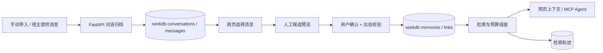

# 言迹 ContextTrace 技术架构

## 目标和边界

用户主动保存网页聊天或 Agent 宿主明确导出的消息。原始 `Conversation` / `Message` 与用户确认的 `Memory` 分开保存：归档不自动生成记忆，未确认候选不能检索。当前初赛必做入口是网页与 MCP；浏览器扩展仍在后续阶段，不是复现前提。

## 数据流

原始消息按 `sequence` 稳定排序，包含平台、角色、来源 URL（只有真实可取得时）和采集完整度。聊天记忆必须引用同一 scope 的已归档消息，并校验 `source_excerpt` 是原文连续片段。文档/Git/Issue/人工来源至少提供稳定 `source_ref` 与原文片段。API 中 BIGINT ID 全部按十进制字符串传输。

## 服务与存储

- `python/yanji/server/api.py`：FastAPI HTTP 路由、错误码、CORS、健康检查；安装 MCP 可选依赖后在同一进程挂载 `/mcp`。
- `python/yanji/server/mcp_server.py`：Agent 工具，直接调用与 HTTP 相同的 repo 函数；宿主未提供的历史不能读取。
- `python/yanji/store/repo.py`：对话归档、消息去重、列表/详情；`memory_repo.py`：人工预览/确认及直接记忆写入；`retrieval.py`：过滤、关键词/向量候选、RRF、预算、上下文；`version_repo.py`：显式版本替换和单条记忆遗忘；`trace_repo.py`：读取实际轨迹。
- `python/yanji/store/schema.sql`：seekdb 9 张表，包含原始对话、消息、候选、记忆、证据关联、轨迹、版本及幂等记录。`scope` 只做数据过滤，不等同身份认证；本地 Demo 仅监听 `127.0.0.1`。
- `web/src/data/archiveApi.js`、`web/src/data/memoryApi.js`：网页真实 API 适配；默认 mock 仍可供无数据库队员开发。真实模式报错不会偷偷回退到假数据。

## 检索与预算

默认 `keyword` 在 scope、`active`、有效期、来源等条件下检索内容。设置 `YANJI_EMBEDDING_BACKEND=hash` 后，记忆写入时生成 1024 维字符特征向量，旧记忆通过 backfill 命令补齐；向量通道按 seekdb 的 `L2_DISTANCE` 取候选，混合模式对关键词与向量候选去重并使用 RRF（常数 60）融合。向量通道**不受关键词命中条件约束**。

当前关键词 SQL 最多取最近 200 条命中候选并在 Python 中重排，向量 SQL 最多取 100 条；最终上下文用 `utf8-bytes/3` 估算 Token，先尝试正文，再尝试摘要，仍超预算则跳过。这个 Token 值是估算，不是某个模型的精确计数；超过候选深度的旧记忆可能漏召回，D12 结果须同时说明此限制。

这个本地向量模型只基于字符 n-gram 哈希，便于在无付费模型 API 的环境里验证 seekdb 向量索引和混合流程。它不是神经语义模型，不能把本基线的结果表述为语义召回质量。未启用时，请求 `vector`/`hybrid` 返回明确的 `EMBEDDING_UNAVAILABLE`。

预算选择按候选顺序尝试正文、摘要、跳过；不截断出处。Token 统计为固定的 `utf8-bytes/3` 近似值，结果标记 `is_estimate=true`。用户取消勾选时 `/v1/memories/context` 只处理提交的有序 ID，不再搜索或补入其他记忆。每次检索保存候选通道、融合名次、预算决定和耗时，召回页只读取这些记录。

## 复现与当前证据

- [复现命令](reproduction.md)
- [每日验收与未完成项](RESULTS.md)
- [API 与数据契约](api-data-contract.md)
- [AI 使用与人工验证记录](AI_USAGE.md)

真实 seekdb 尚需本轮重新启动并完成 D4–D14 逐项验收；静态测试和前端构建通过不代表数据库或 Agent 宿主联调已通过。
